# 🌸 卿_秋梦辞 (Qing-qiumengci)

---

### 🏮 卷首语  
> 「佛又曰：咩悉数阿墀陀唎耶埵沙羯埵钵呼醯啰室沙曳那哆蒙娑舍钵萨娑帝诃呼怛俱吉漫」

 

---

### 🐍 蛇行 · 星轨

> *“星子循迹，吞食昼夜，终成归途。”*

  <picture>
    <source media="(prefers-color-scheme: dark)" srcset="https://raw.githubusercontent.com/Qing-qiumengci/Qing-qiumengci/output/github-snake-dark.svg" />
    <source media="(prefers-color-scheme: light)" srcset="https://raw.githubusercontent.com/Qing-qiumengci/Qing-qiumengci/output/github-snake.svg" />
    
  </picture>

---

  <strong style="font-size:1.2em; color:#8839ef;">“入梦者，已逾此数矣。”</strong>

  

  <em style="color:#aaa; font-size:0.9em;">✨ 每一次停留，都是梦的回响</em>

